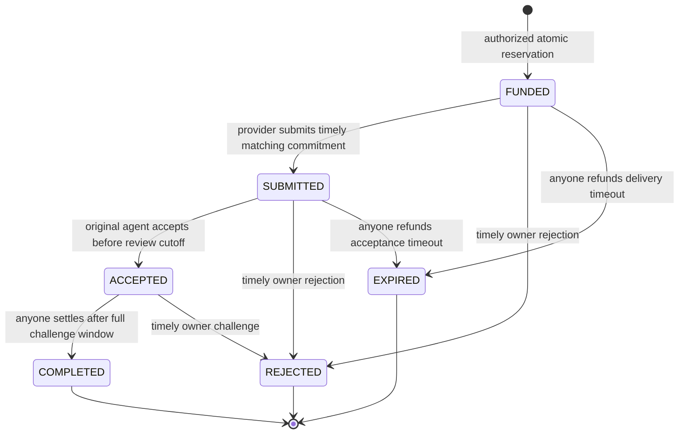

# Earmark protocol architecture

> **Legacy Monad architecture reference.** Preserved from the source migration.
> Deployment claims and environment bindings below apply to the original Earmark,
> not Earmark PayPal. See [PayPal integration architecture](paypal-integration.md)
> and [migration report](migration/implementation-report.md) for this application.

Status: **Stage 7 additive local security evidence and recording over the preserved Earmark workspace and Stage 4/5 contract/runtime boundaries. No external deployment.**
`TaskVault.sol` uses Solidity 0.8.28 and OpenZeppelin 5.6.1. Stage 1 and Stage 2
reports remain historical records. This implementation is not externally audited
and does not claim formal ERC-8183 compliance or production delivery guarantees.

## Authority and immutable mandates

The owner controls deposits, unreserved withdrawals, mandate creation/revocation,
and timely payment rejection. OpenZeppelin `Ownable2Step` requires acceptance of
an ownership transfer; renunciation is disabled. The **current accepted owner**
controls disputes, including payments funded under a previous owner. There is no
proxy, upgrade administrator, arbitrary executor, agent withdrawal, or ERC-20
approval granted to an agent/provider. Agent and owner must differ at mandate
creation; a deliberate later ownership transfer can combine those roles.

Each unique, nonzero task hash identifies one immutable mandate:

```solidity
struct Mandate {
    bytes32 taskHash;
    address agent;
    address token;
    uint128 cap;
    uint128 reserved;
    uint128 settled;
    uint64 expiry;
    bool active;
}
```

Agent, token, cap, expiry, provider membership and delivery terms cannot be
edited. Revocation changes only `active`. Task identifiers cannot be recreated
after expiry or revocation to reset spending history. `taskHash` is an identifier
or byte commitment, **not proof that a transaction semantically matches a
natural-language task**. The model and provider output remain untrusted.

The constructor explicitly approves exactly one conventional ERC-20 contract for
the vault's lifetime. All mandates, deposits, withdrawals and requests must use
it. Token code presence does not certify behavior. Local tests use six-decimal
mock USDC, with exact integer base-unit accounting and no real funds.

Providers are copied into immutable per-task membership and enumeration storage.
Empty lists, duplicates, zero addresses and the vault itself are rejected.
Historical membership remains queryable after revocation. A payment selects one
approved provider at funding and permanently binds that exact recipient.

**Mandate creation does not lock or preallocate funds.** A cap is authorization,
not guaranteed funding. Multiple mandate caps may exceed current vault liquidity.

## Authorization and atomic funding

`checkAuthorization` remains a read-only, non-binding preflight. It neither
reserves funds nor creates a reusable authorization ticket. Its reusable internal
routine checks:

1. Mandate exists, is active, and `now < expiry`.
2. Caller is the designated agent.
3. Exact provider belongs to that mandate.
4. Token matches, and amount is positive.
5. Reserved plus settled plus requested amount does not exceed the cap.
6. Actual token balance minus **all** outstanding reservations covers the request.

Counters are widened and headroom is subtracted before comparison to avoid
arbitrary uint256 request overflow. Two preflights can both pass against the same
liquidity. `requestPayment` reruns all checks, then increases both ledgers and
creates the complete payment record in one guarded transaction. A failure rolls
back the entire reservation and record. No token leaves the vault when funded.

Requests carry a nonzero, client-selected `bytes32 requestId`. Payment identity is:

```text
keccak256(abi.encode(chainId, vaultAddress, taskHash, authorizedAgent, requestId))
```

A record persists permanently, including after terminal resolution. Reusing a
request ID in the same domain reverts; a failed request does not consume it.
Different tasks/vaults/chains have separate domains. Reorganizations and uncertain
receipts require clients to reconcile the deterministic ID before retrying.
Fresh request IDs intentionally allow repeated purchases with the same provider
and amount, within the remaining mandate cap and shared liquidity. There is no
signed quote or externally unique purchase object to deduplicate. Clients must
reuse a stable purchase/quote-derived request ID for retries and reconcile its
record; generating a fresh ID for a retry defeats client idempotency. A malicious
authorized agent can still choose fresh IDs within its authorization. Neither IDs
nor hashes prove unique semantic work. A future once-only quote policy needs an
explicit owner-authorized quote identity and separate design review.
There are no signatures, relayers, or meta-transactions in this stage.

## Payment records and verification terms

Each payment snapshots task/request IDs, agent, exact provider, token, amount,
funding time, delivery/review deadlines, challenge duration and expected deliverable
hash. Later lifecycle calls use these snapshots rather than mandate activity or
expiry. Acceptance adds its timestamp/challenge deadline; submission adds the
provider's deliverable commitment. No redirect, edit, partial-payment or
resubmission function exists.

`DeliveryTerms` retains the Stage 2 tuple shape:

- `deliveryWindow`: 1 hour through 30 days from funding.
- `challengeWindow`: 1 hour through 30 days from agent acceptance.
- `trustedDeliverableHash`: optional owner-trusted exact-byte commitment; zero
  means no expected hash is configured.

Only the designated provider can submit a nonzero commitment. A configured
expected hash must match exactly. Neither a provider hash nor an expected hash
proves usefulness, truth, availability or semantic correctness. The authorized
agent accepts delivery; the owner must monitor and dispute inadequate delivery.
The contract has no oracle, independent verifier, adjudicator, evidence storage or AI call. Stage 5 adds deterministic offchain inspection; it does not prove semantic correctness.

## Lifecycle and dispute rules



`NONE` represents an absent record and is never a funded payment status.
`COMPLETED`, `REJECTED`, and `EXPIRED` are permanent terminal states. Every payment
may resolve once. Submission/acceptance transfer no tokens. Acceptance cannot
be repeated to reset the challenge window.

The **owner is the trusted unilateral dispute authority for the MVP**.
`rejectPayment` immediately finalizes an eligible payment as `REJECTED`, releasing
its reservation into available vault liquidity. It emits a public nonempty reason
of at most 256 bytes. There is no pending-dispute state, independent appeal,
arbitration timeout, split outcome or provider recourse on chain. The owner can
reject even a valid delivery before the applicable cutoff. Providers must trust
this authority; this explicitly replaces the earlier future-arbitration proposal.

At/after the accepted payment's challenge deadline, owner rejection is closed and
anyone may settle to the original provider. An accepted payment has **no timeout
refund**, even years later. Under the conventional token assumption it must settle
unless the owner rejected it in time. Timely rejection is terminal and can never
later become a payout. Callers must submit transactions; deadlines do not execute
automatically and there is no keeper integration.

## Deadline semantics and liveness

| Deadline       | Meaning                                   | Derived value                                        |
| -------------- | ----------------------------------------- | ---------------------------------------------------- |
| Mandate expiry | Final boundary for new requests only      | Immutable absolute mandate timestamp                 |
| Delivery       | Provider submission boundary              | Funding time + deliveryWindow                        |
| Review         | Agent acceptance boundary                 | Delivery deadline + fixed REVIEW_WINDOW (2 days)     |
| Challenge      | Owner rejection boundary after acceptance | Actual acceptance time + snapshotted challengeWindow |

Submission, acceptance and owner rejection require `now <` their applicable
cutoff. Timeout refund and settlement require `now >=` their applicable cutoff.
There are no ambiguous exact-boundary gaps. FUNDED rejection uses the delivery
cutoff; SUBMITTED rejection uses the review cutoff; ACCEPTED rejection uses the
challenge cutoff. After the first two cutoffs anyone can refund instead.

The review deadline is a maximum acceptance cutoff, even for early submissions.
Acceptance ends review immediately and starts the full challenge duration.
Therefore early acceptance can produce a challenge deadline **before the unused
review maximum**. A late acceptance still gets the entire configured challenge
window. The agent cannot select or shorten that duration.

Funding uses checked uint64 conversions, including the latest possible
review-plus-challenge bound. No truncating cast can create an unreachable future
resolution. Expiry/revocation only blocks new authorizations and never cancels
existing escrow. Delivery, acceptance, owner rejection and settlement can
continue beyond mandate expiry when their own deadlines permit.

With a conventional functioning token, every funded payment can reach a terminal
state: missing delivery expires at delivery cutoff, missing acceptance expires
at review cutoff, and accepted delivery settles after challenge or is timely
rejected. Failed token transfers roll back to ACCEPTED and may be retried; a
permanently blocked/malicious token can prevent payout. No administrator bypass
refund is added to accepted payments to conceal that token assumption.

## Accounting invariants and refund semantics

```text
mandate.reserved + mandate.settled <= mandate.cap

totalReserved = globalReserved(approvedToken)
              = sum(all mandate reserved)
              = sum(FUNDED + SUBMITTED + ACCEPTED payment amounts)

totalReserved <= actualTokenBalance
availableBalance = actualTokenBalance - totalReserved
```

The existing single-token `totalReserved` remains the authoritative global
ledger. `globalReserved(token)` exposes it by approved token address and rejects
unsupported tokens; no duplicate or drifting ledger is introduced.

| Transition for amount x | Mandate reserved | Global reserved | Mandate settled | Token movement                     |
| ----------------------- | ---------------- | --------------- | --------------- | ---------------------------------- |
| Funding                 | +x               | +x              | unchanged       | none                               |
| Settlement              | -x               | -x              | +x              | exactly x to snapshotted provider  |
| Rejection/timeout       | -x               | -x              | unchanged       | none; held tokens become available |

Refunds restore spending headroom and never change historical settled spending.
Cap 100, reserved 40, settled 30 has 30 headroom; refunding 40 leaves settled 30
and restores headroom to 70. A settlement permanently consumes budget, even if
the owner refills the vault. Refunds create no duplicate token credit or transfer
to an agent. All effects and terminal status changes are atomic.

Two tasks reserving 60 and 30 against actual balance 100 leave only 10 available
to either mandate or the owner. Mandate creation never contributes to this sum.
Revocation does not release a reservation. There are no deferred claimable
credits or off-ledger unpaid liabilities in this implementation.

## Token safety and security boundaries

Owner deposits use SafeERC20 and verify exact received balance deltas. Withdrawals
exclude all reserved funds, verify exact vault debit and recipient credit, and require a positive
amount/valid recipient. Direct approved-token donations increase available funds.
Unsupported direct token transfers cannot be prevented and have no recovery API;
native-token funding is unsupported.

Every payment lifecycle operation, deposit and withdrawal is protected by
ReentrancyGuard. `checkAuthorization`, `availableBalance`, `globalReserved` and `getPayment` reject reentrant observations. Raw storage getters such as `totalReserved` and `getMandate` remain readable during token callbacks; they may show effects before the token interaction finishes and are not atomic liquidity certificates for external composable contracts. Settlement verifies aggregate backing, updates state and both
ledgers before SafeERC20 transfer, then verifies exact vault debit **and provider
credit**. Detected false returns, outgoing recipient fees or excess sender debits
revert all effects. No agent approval or arbitrary call mechanism exists.

These checks do not make rebasing, fee-changing, callback-enabled, malicious,
blacklisting or upgradeable token behavior supported. A token may lie about its
balance or change behavior after approval. Negative rebases can invalidate
backing outside vault control; subsequent financial operations fail closed.
Incoming/outgoing delta checks detect observed deviations, not every possible
token implementation. Stage 4 closes a detected owner-withdrawal recipient-fee
gap: both withdrawal and settlement require exact recipient credit and revert
atomically on a detected fee or extra credit. This does not approve unusual tokens.

Owner compromise permits hostile mandates, withdrawal of free funds and timely
unilateral rejection. Agent compromise can reserve/accept within immutable caps
and allowlists; it cannot withdraw or redirect. Repeated refunded reservations
can consume time/gas because refunds restore headroom, and there is no rate limit
or gas sponsorship. An offline owner can miss the challenge window. A colluding
agent/provider can obtain optimistic settlement absent timely owner action.

Consensus timestamps and transaction ordering determine cutoffs; no wall-clock
precision or fair inclusion guarantee is claimed. Chain reorganizations, RPC
trust, confirmation policy and Monad-specific deployed execution remain future
integration concerns. Local configured EVM tests/gas do not prove deployed parity.
There is no external audit, formal proof, emergency response infrastructure,
formal ERC-8183 certification, production guarantee or deployment in this stage.

## Verification and future work

Stage 2 tests remain intact, including their explicitly test-only accounting
snapshot subclass. Stage 3 units/fuzz tests use the production contract; stateful
handlers create real payment records, reconcile live escrow sums and caps, assert
conservation/immutability, and resolve all remaining payments at campaign end.
Adversarial token tests check rollback and authorized callback blocking. Default
invariants use 64 runs × 64 calls; CI uses 256 × 128 with fail_on_revert enabled.
These are bounded tests, not formal verification.

Stage 4 adds a 105-scenario lifecycle matrix, deadline/integer boundary tests,
replay and ownership adversarial tests, malicious token edge cases and a second
stateful campaign with varied agents/providers/terms and ownership operations.
Each campaign checks its properties together after generated calls. Handler action
counts include guarded skips; successful transitions and expected failures are
counted separately, with deterministic coverage assertions. See the
[Stage 4 security report](stage-4-security-report.md) for findings, static-warning
dispositions, concrete verification and deployment limitations.

Stage 5 adds a local server-side autonomous tool loop; the Solidity source, ABI,
storage and original tests are unchanged. See [agent runtime](../agent/README.md)
and [Stage 5 report](stage-5-report.md). Stage 6 integration is described below.
Independent security review and explicit deployment authorization remain required
before real-value use. Neutral arbitration, partial outcomes, signed requests,
multiple tokens or upgrades require a separately reviewed design.

## Stage 5 agent boundary

A trusted owner assigns taskHash, instruction, exact-unit budget and a stable
purchaseKey. `AgentModel.decide` returns a strictly validated tool proposal or
finish summary. The deterministic MockModel works offline; a Qwen-compatible
function-calling adapter is available with explicit server configuration and no
silent fallback. No live paid inference was used. Model summaries are logged,
never hidden reasoning. Only the eight requested mandate/provider/payment tools
exist; they cannot create mandates, withdraw, transfer, export secrets or execute
arbitrary calldata. The signer builds only the original request/accept calls.

Owner and agent burners differ. Startup and signing check actual local chain ID,
expected vault address/runtime code hash, approved token and current owner/agent
separation. Stage 5 broadcasting is limited to loopback Anvil 31337; Monad 10143
metadata remains for later authorized integration. Server keys never enter model
context, frontend, logs or persistent journal. The local fixture owns setup,
provider submissions, clock advancement and permissionless settlement; these are
separate actors, not extra agent permissions.

The approved-provider registry maps service IDs to exact onchain members. DataHub
quotes 6 mock USDC and WeatherCo 8; untrusted strict quotes bind task/token/price,
expiry, ID and artifact commitment. The model chooses a received quote ID, while
deterministic code checks available liquidity, cumulative cap and all associations
before signing. Addresses/amounts cannot come from model output. These quote checks
are offchain and are not signed quote enforcement by TaskVault.

Structured weather delivery binds quote/task/provider and actual payment ID.
Schema-normalized JSON commitment must match the quote and actual provider
submission, plus the owner-trusted hash when present. Only a successfully inspected
SUBMITTED record may be accepted. This proves configured byte/structure checks,
not factual accuracy or semantic quality. A provider's text remains untrusted
user data. The malicious fixture records mock-policy behavior; live Qwen attack
resistance remains untested. Bad acceptance plus missed owner challenge can pay
for inadequate work, as before.

Application idempotency hashes trusted chain/vault/task/agent/purchaseKey and binds
the selected quote into requestId. An exclusively locked, atomically replaced
journal persists immutable intent/payment IDs and transaction hashes/nonces before
broadcast. No raw signed transaction or signing key is saved. Existing requests
and acceptances reconcile receipts and exact escrow records after uncertain RPC
results. There is no blind resend, automatic replacement, retry with a fresh ID
or automatic reopening of a terminal intent. A legitimate new purchase needs a
new trusted purchaseKey. Journal loss/tampering, separate writers/files, reorgs or
an unresolved nonce need manual operational review; a compromised agent key can
still use fresh IDs within its immutable cap. This does not change onchain authority.

The autonomous loop reports ACCEPTED/challenge or observed terminal status. The
local demo verifies early settlement rejection, then a separate observer settles
only after the full deadline; invalid delivery can resolve via the existing
permissionless timeout. There is no production keeper or owner monitoring service.
One local confirmation is demonstration evidence, not a production finality policy.
Original owner-dispute, refund, revocation and settlement semantics are preserved.

## References

- [OpenZeppelin ownership](https://docs.openzeppelin.com/contracts/5.x/access-control)
- [SafeERC20](https://docs.openzeppelin.com/contracts/5.x/api/token/erc20#SafeERC20)
- [ReentrancyGuard](https://docs.openzeppelin.com/contracts/5.x/api/utils#ReentrancyGuard)
- [Foundry invariant target ABI](https://github.com/foundry-rs/forge-std/blob/master/src/StdInvariant.sol)
- [Monad execution differences](https://docs.monad.xyz/developer-essentials/differences)

## Stage 6 browser and server boundary

The light-blue liquid-glass workspace uses real React/CSS panels, no reference-image
background and no permanent sidebar. Injected EIP-1193 wallets (including EIP-6963
discovery) provide the owner's account, network, signatures and narrowly constructed
owner transactions. The browser never imports the server signer/runtime barrel.
All balances, mandate accounting, payment states and deadline controls come from
actual contract reads; event timestamps identify observation time versus block time.
Empty or unavailable state stays empty or visibly stale. Mock provider behavior and
Deterministic Mock/Qwen mode are explicit.

The additive `@flint/agent/task` helper computes a versioned task identifier from
vault, trimmed description and a fresh salt. Creation validates exact token units,
designated agent, registry providers, expiry and original contract duration bounds.
A confirmed MandateCreated receipt plus matching task hash registers immutable
offchain description metadata. Existing unregistered mandates remain visible but
cannot run with invented task descriptions. The acceptance period remains the
contract's fixed two days; it is not a new editable mandate term.

Owner launch authorization uses EIP-712 domain `Flint Owner Launch`, version 1,
chain 31337 and the exact vault. The signed action, mandate ID, stable purchase
intent, random single-use nonce and two-minute expiration are checked server-side
against the current onchain owner. Nonce consumption and run creation are durably
atomic. Different valid nonces cannot create a second UI purchase for that mandate.
An explicit signed resume may reconcile an interrupted/failed run with its original
purchase intent, including existing escrow after mandate expiry/revocation. It does
not restore revoked authority; TaskVault still checks every new request.

The server composes the existing AgentTools, model adapter, simulated provider
schema/inspection and locked purchase journal rather than duplicating the spending
policy. The agent still has only eight tools and request/accept signing capabilities.
Separate server-only provider burners submit actual delivery commitments. No agent
or provider key enters browser payloads, model context or event storage. Owner
transactions use exact deposit approvals and fixed TaskVault calls; receipt identity
and target are checked. Uncertain owner hashes survive refresh and block blind
resubmission; uncertain agent transactions use the original journal reconciliation.
Receipt recovery matches hash, vault and chain before clearing pending state, so
delayed approval receipts cannot consume a newer deposit record.

The local Node service appends validated run events synchronously to a locked,
fsynced, atomically replaced workspace journal. Bounded polling recovers snapshots
and stable event IDs after refresh, without resending writes. Confirmed contract
logs reconstruct mandate/payment history from the configured deployment block,
using bounded 1000-block chunks. A history over 20,000 blocks, observed reorg,
corrupt state, wrong genesis or stale lock fails closed and needs operator review.
The UI timeline only marks authorization after an actual funded payment record.
Settlement, refunds and owner rejection retain Stage 3/4 semantics and deadlines.

The local launcher creates a fresh Anvil chain and four separate random burners,
mints mock USDC to the owner, and supplies server secrets through process environment.
It performs no vault deposit or mandate creation. Optional owner import material
stays in an ignored development file. The browser demonstration uses a test-only
injected provider bridge with Node-held owner signing; it is not evidence of live
MetaMask/Rabby extension UI testing. Test-only clock advancement reaches full
configured deadlines outside the production app. There is no time-control API.
The local fixture mines empty blocks every five seconds so idle deadline displays
advance with actual chain time; it never shortens the configured windows.

This is a local single-worker application, not a hosted multi-tenant product.
A persistent server and trusted durable journal storage are required; serverless
request cancellation, concurrent workers, journal loss, nonce replacement and
production reorg/finality policies require further work. EOA signatures are supported;
smart-contract owner authentication is not implemented. Loopback visitors can read
workspace data; authentication protects launches, not activity confidentiality.
Public deployment needs independent review, request throttling/privacy controls,
monitoring/keepers, durable database operations and deployment authorization.
A compromised agent can still issue fresh onchain requests within its cap. Neither
quote validation nor commitment checks prove semantic delivery quality. No paid
Qwen inference, public-chain deployment, audit certification or formal compliance
claim is made. Stage 7 local demonstrations are documented below; Stage 8 requires separate approval.

## Stage 6.5 public identity

Earmark is the approved public name. The blue crystal asset, official copy, screen terminology and metadata change presentation only. TaskVault bytecode/ABI/storage, agent capabilities, immutable mandates, escrow transitions and owner launch authorization remain unchanged. The existing Flint Owner Launch EIP-712 domain and all task/purchase/request identity namespaces, package names, environment variables and durable browser/server storage keys remain stable. Historical reports and repository paths retain provenance; see branding.md.

## Stage 7 — isolated security demonstrations

The external Node demo runner uses the existing local Anvil harness, real compiled
TaskVault/MockUSDC, MockModel, AgentTools and durable IntentStore. Four scenarios
exercise confirmed settlement, prompt-injection text plus independent provider
revert, invalid artifact/owner rejection and cumulative 4+4+4 cap enforcement.
It acquires the existing journal exclusive lock, reconciles repeated intents and
never changes runtime financial capabilities or Solidity logic.

Owner bootstrap, observer settlement, adversarial agent impersonation and full
challenge time advancement are local test-harness actions. They are not model
tools, frontend wallet functions or server financial endpoints. Each scenario
uses a separate fresh 20-USDC owner-funded vault and 10-USDC mandate. The usual
web workspace remains separate; demo addresses and snapshot provenance are shown.

A strict data-only schema exposes sanitized observations, exact receipt hashes,
payment IDs, measured ledgers and assertions. The loopback-only GET
/api/security-demos reads only an absolute server-configured
EARMARK_DEMO_STATE_PATH, with size/shape checks; it has no mutation method or
client-selected path. Atomic snapshots survive browser refresh. The local CLI
controls execution; the UI selects recorded/live-updating fixture results.
Once the fixture chain closes these are clearly described as confirmed snapshots,
not a still-running public chain.

Mock resistance to injection is deterministic policy behavior, not evidence of
live-Qwen robustness. The invalid-delivery case validates artifact byte binding
offchain then uses a timely owner dispute; the contract never certifies semantics.
D's final snapshot has two FUNDED payments, reserved 8/settled 0 and available 12,
with normal timeout/refund paths; the disposable chain is closed afterward.
No public Monad deployment, real money, external audit or paid model call occurs.
See demo/README.md for capture, trust boundaries and local/manual reproduction.

The local application launcher mines one-second blocks to remain below the existing provider timeout. This changes local block cadence only: delivery/review durations and the full configured challenge deadline remain enforced.

## Stage 8A — durable testnet deployment preparation

The hosted Node worker uses PostgreSQL instead of ephemeral local journals, with
immutable intent/transaction identities, autocommitted pre-broadcast records,
session signing locks, a singleton worker lock, and receipt-only startup recovery.
Workspace/nonce/run/event changes are transactional and nonce consumption cannot
be reversed. Environment binding pins the dedicated existing Neon production
branch to Earmark testnet (10143). No keys or raw signed transactions are stored.
Local file adapters and Anvil history remain separate and preserved.

The testnet adapter requires explicit 10143 opt-in, official HTTPS RPC, expected
vault address, vault/token bytecode pins and separate agent/provider/owner identities.
The hosted API exposes bounded read-only state plus only owner-authenticated launch
operations; Next routes proxy to a fixed Render origin and refuse localhost fallback
in hosted mode. Contract logic, ABI, task identity and signing domain remain stable.

Database receipt reconciliation may restore interrupted payment state but never
starts a new purchase, signs, replaces or rebroadcasts a transaction. Owner-authorized
resume continues the same durable intent. Worker/database lock loss stops signing;
after a hard crash committed hashes remain available. Render Free sleep means
execution/settlement is not guaranteed to run continuously. Permissionless resolution
remains a contract property and requires a tested independent wallet route.

The dedicated production database migration is applied; both public testnet contracts and Free/Hobby hosting are deployed and independently verified. A real six-USDC payment funded escrow, received delivery and settled after the full challenge period; accepted-payment restart persistence and owner revocation passed. Final balances are 14 available, zero reserved and six received by DataHub. See deployment.md and stage-8a-deployment-report.md
for evidence and limits. No public deployment success is implied by Neon setup.

The verified deployment manifest pins the deployed six-decimal Mock USDC and
TaskVault owner/token/bytecode on 10143. Testnet history uses at most four
100-block RPC ranges per refresh with a durable cursor, finalized cutoff and
16-block overlap; incomplete history is explicitly marked as syncing.

The /resolve page works independently of the backend and requires no database
credentials. It reads the pinned contracts via public testnet RPC and exposes
only existing permissionless settlement/refund operations. Eligibility is based
on real block timestamps and immutable payment deadlines. It preserves uncertain
wallet attempts across refresh, validates exact transaction identity/calldata and
requires two confirmations before displaying success. It cannot request a payment,
change its recipient or shorten the owner dispute window. A failed public RPC or
missing wallet prevents resolution; no claim of continuous Free-tier settlement
is made. Its actual browser-wallet terminal flow remains a live verification step.

### Rolling worker handover

The hosted listener exposes liveness before acquiring the exclusive direct
PostgreSQL worker-session lock so Render can retire its old instance. Startup
health is not financial readiness: `/ready`, all workspace reads and all POST
operations remain 503 until acquisition, chain verification and receipt-only
reconciliation complete. The worker waits at most four minutes without stealing
or bypassing the lock; termination cancels startup. Lock loss still stops the
process and signing jobs. An old worker drains while holding its lock. Interrupted
transactions retain their journal identities and require receipt reconciliation,
never automatic rebroadcast. Free hosting may therefore temporarily show an
unavailable workspace during a safe handover. Contract settlement is independently
permissionless and remains accessible through `/resolve` when eligible.

## Read-only bundled demonstration projection

The disconnected frontend renders a bundled projection of verified public purchase evidence and original Stage 7 local scenario records. Presentation props never replace the authoritative workspace state used by wallet or agent operations. Replay has no signing, RPC broadcast or financial API path. An asynchronous backend check may update availability but cannot remove the bundled record. Connected-owner operations continue to use live chain snapshots, unchanged signed single-use launch authorization and durable purchase-intent reconciliation.

Recorded Monad transfers, local Anvil receipts, deterministic model behavior and backend validation are labelled separately. The shared five-stage lifecycle reserves Earmarked for confirmed funding and Settled for a confirmed terminal transfer; its owner challenge countdown begins only after acceptance. See pre-submission-ui-report.md for exact public receipt provenance and scenario classifications.
