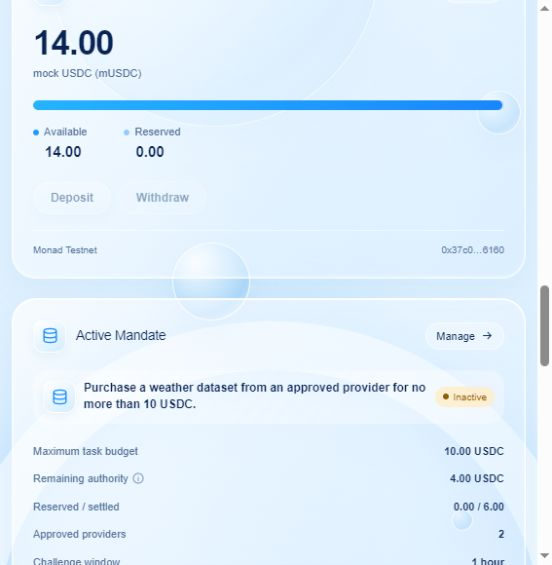
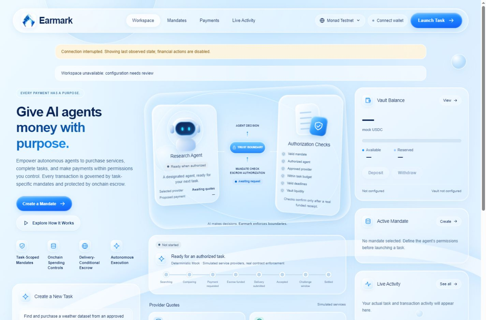

# Earmark Stage 8A — deployment report

Status: **complete for the approved free-tier testnet demonstration**, with the limitations below.

## Final verified outcome — October 12, 2026

The owner settlement [transaction](https://testnet.monadscan.com/tx/0x95810b4c31144e9b044955d7fc9b4e9dc055fb6842aaab495ea677a9a0a66e25) succeeded at block 70428175, using 195825 gas. Exact owner sender, chain 10143, vault recipient, zero MON value, settlePayment calldata, successful receipt, confirmations, PaymentCompleted event and exact ERC-20 Transfer were independently verified. Settlement occurred at **16:02:47 Africa/Lagos**, **130 seconds after** the full challenge deadline. No time manipulation or early release occurred.

| Final value                |   mock USDC |
| -------------------------- | ----------: |
| Vault actual balance       |       14.00 |
| Available balance          |       14.00 |
| Global reservations        |        0.00 |
| DataHub received           |        6.00 |
| Mandate reserved / settled | 0.00 / 6.00 |

The payment is COMPLETED. Owner revocation remains effective; it did not prevent the existing escrow from settling. Read-only repeated settlement and refund attempts both revert InvalidPaymentState. One durable purchase intent, one completed run and exactly one PaymentCompleted event persist in the existing Neon production database; confirmed request/acceptance hashes and three consumed owner authorizations remain. Public refresh without an owner wallet recovers completed history, actual balances, inactive mandate and matching settlement activity. Hosted health/readiness return 200; five public auth/origin/route probes and four frontend route/brand/secret checks passed after settlement. Fourteen served chunks contain zero configured secrets.

Public purchase evidence is saved in [monad-testnet-purchase.json](../deployments/monad-testnet-purchase.json). Screenshot:

Latest validation of unchanged tested implementation: 383 regressions (176 Solidity, 102 agent, 105 web/server), formatting, lint, types and production build; seven targeted resolver/availability browser cases. The earlier nineteen browser cases, four local security demos and five real-Neon persistence/recovery cases are recorded below separately. No assertions or financial protections were weakened. This closing follow-up changes documentation and public evidence only.

All mandatory deployment completion criteria are met. Live Qwen remains unavailable; deterministic mock mode and simulated services are explicit. Render Free may sleep, one owner controls the example vault, and the review is not an external audit or production certification. Recommended next steps: retain exclusive signer custody, monitor free-tier availability, conduct separately authorized live-model evaluation, and obtain further security review before any real-value use. No additional stage is started.

## Current public status and owner funding — 2026-10-12

- Frontend: https://earmark-omega-virid.vercel.app/ — Vercel Hobby Production Ready at source `8211181aab02ee9149cb73a0d0f75f2c252c9b77`, deployment `F6tQNvxpMAVVRd1d9kT1utmmgf43` (1m12s). The approved repository-only samuelid22 identity resolved the Git-author block without rewriting history or upgrading plans.
- Backend: https://earmark-api-testnet.onrender.com — Render Free, tested source `a3343f971dd18dc7350a09fdd16ead29ea0ecc94`. Health/readiness returned 200 after a controlled same-source restart, with the existing Neon production binding and cursor preserved.
- Public workspace caught up after 333 bounded read-only history requests. It identifies Monad Testnet, the verified vault/token and deterministic mock mode. Five origin/auth/execution-disabled probes passed, and four public routes plus fourteen browser chunks passed branding and actual-secret checks.
- Owner mint confirmed at block 70152608: `0x26e470310a8d8841e8bdfb2057d5579ff5ca7ac38d4a9b079b125e15b1b0b18c`. Exact chain/sender/token/calldata, success and two confirmations were verified without broadcasting.
- Owner deposit confirmed at block 70156750: `0x90cb33d697a8af1d62069b57718f8c9dc1df6c148484741cc51d1d73a2881088`. The successful vault Deposited event identifies the current owner, approved token and 20,000,000 base units. At the deposit checkpoint available balance was 20.00 mock USDC, global reservations were zero, and the owner token balance is zero after funding.
- At the funded-burner checkpoint, agent, DataHub and WeatherCo each had 0.2 testnet MON for gas; execution subsequently consumed gas. Their identities remain separate from the owner. Backend testnet execution was enabled with explicit action-time owner approval. Owner-signed launch authorization is still mandatory; no task starts automatically.

Owner mandate `0x726976efeaeb88296262601bec3ba76581d60c5e0f0e930afecb9d7bcdea5a0c` was created in transaction `0x608010970b13be740c43d1d90b248fa2eca789c15cbc1ea311326f152082355b` at block 70158499. Exact creation calldata, sender, chain, vault, zero MON value, receipt/event and immutable terms were verified against the deployed contract. The 10-USDC cap, both approved providers, designated agent and 3600-second delivery/challenge durations match the owner-approved terms. Creation reserved no funds. Expiry is October 12, 2026 at 17:22 Africa/Lagos; the authority was unexpired when requested and was later owner-revoked.

With explicit owner approval, only `EARMARK_ENABLE_TESTNET_EXECUTION` changed to true on the existing Free Render service. Same-build deployment `dep-db5rm8qjnfac73bgmifg` reused tested `a3343f9` and became Live in 30.8 seconds. Exact flag key/value were verified before saving after an automatic approval review pause. Other credentials, origin, model mode and security settings were preserved. Post-activation unsigned/foreign launch, generic execution and CORS checks passed. Health/readiness returned 200, with PostgreSQL and mock mode. The immutable Neon binding, four contract events and history cursor survived the activation restart.

The October 12 pre-launch checkpoint had zero runs/intents and was catching up after an idle interval. Synchronization subsequently completed without skipping history. The owner launched and then signed Resume & Reconcile for the same durable purchase intent. The first preparation failure occurred before a transaction attempt was journaled; its cause is unproven. Receipt inspection now confirms a real accepted testnet escrow, not a simulated purchase. Browser control recovered and the public workspace displays actual funds and recorded activity.

Run: `0xf4d786f4ac41db0ac8cc41c6b036285195742813fd96c23299db2900eeb2d5f6`.
Payment: `0x003be982f4f5ec1eceb497862bdeb8ac65c0d9a9f4e452324e9dc883af72c98e`.
Purchase intent: `0xd31b6fe4a21d04998e20fc3614122d016c7c40aa001202b4402ab6d620eb743a`.
The deterministic model compared DataHub (6) and WeatherCo (8), selected DataHub, inspected the bound structured artifact and accepted delivery. The selected provider remains the snapshotted authorized address.

| Confirmed operation           | Transaction                                                          | Block    | Gas used |
| ----------------------------- | -------------------------------------------------------------------- | -------- | -------- |
| Request / reserve 6 mock USDC | `0xb2013539e53edc96a55b70b6248763404ae06c25d5520ed2a9d7447a6105d9d7` | 70415815 | 269479   |
| DataHub submission            | `0x0d3818a89a0d28edc8d9aebc11564c2b2080e7e77dce945d8679cd136df6ecd4` | 70415821 | 66809    |
| Agent acceptance              | `0x17aebce0038397928c7fd9a73b3b20359eafd98cb5bdd522e4513166e235739c` | 70415827 | 49493    |

Every receipt was independently checked for success, sender, chain 10143, vault recipient, exact function/calldata and zero MON value. At this checkpoint the vault holds 20 mock USDC: 6 reserved and 14 available. This mandate has 6 reserved, 0 settled and 4 remaining authority. The accepted payment's challenge deadline is exactly acceptance-block timestamp plus 3600 seconds: **October 12, 2026 at 16:00:37 Africa/Lagos**. No testnet time manipulation or early settlement was performed. Funds have not yet transferred to DataHub.

Existing Neon production stores one intent with the same request/acceptance hashes, one awaiting-challenge run, validated quotes and three consumed authorization nonces. Read-only live contract simulations reject unauthorized provider, 5-USDC cap overrun, 15-USDC withdrawal against 14 available, agent withdrawal and early settlement with their specific custom errors. These are eth_call results, not invented reverted-transaction receipts. A controlled same-source Render restart completed while accepted escrow remained outstanding. Replacement instance `kgvwp` reached `api.ready` at 14:18:05 UTC on October 12. Health/readiness returned 200. Exact before/after comparison retained one intent and run, the same request/acceptance hashes and payment ID, unchanged three consumed nonces, and advancing history cursor. No duplicate financial request appeared. Five origin/authentication/route checks passed after restart. This verifies accepted-payment restart persistence; uncertain-broadcast recovery is additionally covered by the previously passed isolated PostgreSQL/Anvil integration tests.

The owner resolved a disabled deposit button by explicitly switching Rabby's active application connection to Monad Testnet. Adding a custom network alone had not switched it. No owner, chain or offline gates were weakened.

Added a loopback-only owner mint helper and Windows instructions. It pins the existing deployment, permits only exact 20 mock-USDC minting to the approved owner, keeps keys inside the injected wallet and exposes GET-only public setup routes. Pending unknown outcomes block before RPC reads; known hashes undergo exact receipt reconciliation with no resend. It cannot deploy or perform vault/agent operations. A hostile public RPC or saved browser state cannot grant signing authority.

Added allowlisted backend availability messages for history synchronization, startup and cold starts. A further tested UI correction distinguishes unknown/loading mandate data from a confirmed empty vault and hides duplicate-creation guidance until a current snapshot exists. Last observed state is retained while financial actions remain disabled; unknown server text is never displayed. No contract, agent tool, journal or launch-signature rule changed.

Latest unknown-mandate UI verification passed all seven resolver/availability browser cases with stronger loading and recovery assertions. Validation: clean `npm run check` passed all 383 existing regressions (176 Solidity, 102 agent, 105 frontend/server), formatting, lint, types and production build. Six new receipt-only helper unit cases passed separately. The nineteen-case browser campaign passed eighteen; its uncertain-mint fixture exposed an RPC-outage dependency. Corrected the helper to reject unknown pending outcomes before RPC access and strengthened the fixture to assert zero RPC calls and zero broadcasts. All four final funding browser cases then passed, alongside the other fifteen cases. All four security browser scenarios passed again on local Anvil: completed purchase, independent unauthorized-provider revert, owner rejection and cumulative cap rejection. Test-only Anvil time advancement applies only to those local regression scenarios.

Owner launch, real escrow funding, delivery, acceptance, the full challenge period and terminal settlement are verified. Accepted-payment hosted restart/reconciliation and owner revocation passed. Live Qwen remains unavailable; mock mode is explicit. Historical notes below describe earlier checkpoints and must not be read as current hosting status.

## Render credentials and rolling-restart follow-up — 2026-10-11

The owner securely imported the existing ignored configuration. Render Free
service `earmark-api-testnet` (`srv-db5ctu3rjlhs73d7t71g`) was created from tested
source `cefe91c5041a5491e01a6bf407f126f1bb5d0b8f`, using Node 22.23.3, Frankfurt,
repository root, the documented build/start commands, `/health` and auto-deploy
Off. Its actual URL is https://earmark-api-testnet.onrender.com. No paid plan,
new Neon project, duplicate contracts or additional credentials were created.

Initial `/health` and `/ready` returned 200 with chain 10143, PostgreSQL and
explicit mock mode. Twenty-two bounded history refreshes reached authoritative
workspace state: available/reserved/actual balance zero, no mandates, payments,
runs or events. Five public security probes passed: foreign-origin launch and
preflight rejection, correct-origin execution-disabled rejection, no generic
execute route and exact-origin CORS. These are readiness checks, not a purchase.

A controlled restart exposed `WORKER_ALREADY_RUNNING` on the replacement.
[Render keeps the original instance until its replacement passes health, then
signals the original after 60 seconds](https://render.com/docs/deploys). Taking
Earmark's exclusive signing lock before binding the listener prevented that
handover. The correction preserves the same direct PostgreSQL session lock:
only `/health` responds during startup (status `starting`); application/readiness
routes return 503 `WORKER_STARTING`. Activation requires exclusive acquisition,
onchain readiness and receipt-only reconciliation. Contention is bounded at four
minutes and shutdown cancels acquisition. No lock is stolen or disabled, no
transaction is rebroadcast, and lost-session termination is unchanged. Shutdown
waits for active HTTP requests and tracked agent jobs before releasing the lock;
a request completing its body after shutdown is rejected.

Five new tests cover contention, bounded failure, cancellation, in-flight HTTP
draining and HTTP gating
until receipt recovery. All 13 targeted new/existing hosted tests passed. Full
post-fix regression passed 383 tests (176 Solidity, 102 agent, 105 web/server),
formatting, lint, strict types and production build. Browser checks passed five
wallet cases, two resolver cases, three owner workflows and four security demos.
The local readiness launcher now allows five seconds for each cold RPC-backed
snapshot within its unchanged 90-second startup bound. Historical screenshots
and evidence were restored from exact pre-campaign backups. Deployed restart
verification now passed on correction commit
`a3343f971dd18dc7350a09fdd16ead29ea0ecc94`: Render deployment
`dep-db5qg6navr4c739nfi3g` is Live, and an explicit restart produced a new
worker (`f4l7q`) with `api.ready`. Public health/readiness both returned 200.
The existing Neon cursor advanced from 69961292 to 69961675 with unchanged
testnet binding and zero intent/nonce/run/event counts. This proves empty-state
restart readiness and cursor persistence; pending-payment restart remains untested.
After the long idle interval, public workspace reads are catching up through
bounded 100-block RPC ranges and truthfully return `HISTORY_SYNCING` until current.
The immutable production database binding and history cursor `69961292` were
recorded before restart; intent/nonce/run/event counts were zero.

Vercel Production now has the nonsecret actual backend URL and exact
`FLINT_WEB_ORIGIN=https://earmark-omega-virid.vercel.app`. These settings are active in the Ready frontend deployment recorded above. Its temporary loading text was corrected to
"Connecting to your workspace…". No signing/database/model secret is on Vercel.
Execution remains disabled. Hosted recovery, funded-burner setup, owner wallet
actions and a real terminal testnet payment remain required. Later sections
record historical setup evidence; this section describes the current status.

## Source changes

- agent/src/postgres.ts, existing journal/runner/config/chain interfaces and
  testnet tests: durable storage, awaited event persistence and explicit testnet guards.
- web/src/server/postgres-store.ts, workspace service/store and fixed API proxy:
  persistent nonces/runs/events/history, receipt reconciliation and constrained forwarding.
- api/src runtime/recovery/server/main and its TypeScript configuration:
  hosted testnet-only worker, health/readiness, rate limits and safe restart handling.
- Existing network/wallet/navigation/workspace components: actual chain selection
  and explicit backend wake-up/errors; liquid-glass layout and approved logo preserved.
- PostgreSQL integration/child-process fixtures, hosted tests and owner-deployment
  browser tests: persistence, replay, uncertain broadcast and wallet-result checks.
- Migration/owner-signing scripts, root scripts/dependency lock, render.yaml,
  .env.stage8a.example, Neon policy/tool lock, deployment and project documentation.
  Historical screenshots/demo evidence and the owner's typing edit are excluded.
  Contract financial source and ABI behavior remain unchanged.

## Database integration

Reused Neon Free project `earmark-testnet` / `square-glade-65269089`, existing
`production` branch `br-noisy-frost-barbc8fi`. Authenticated metadata confirmed
its endpoint matches the preserved direct managed connection. No new project,
duplicate MCP entry, paid plan or database reset was created.

Applied additive schema v1 to production with an immutable Earmark testnet/10143
binding. Pre-migration public table inventory was empty. Existing data was not
dropped or rewritten. Repeated migration and independent read-only verification
are recorded in local logs. Private keys, signed raw transactions and API/database
credentials are never purchase/run/nonce records.

New server-side `pg` storage persists stable intent/request/payment identifiers,
quote/amount/trusted recipient/run association, deterministic transaction hash and
nonce/state, provider submission attempts, launch nonce/consumption, runs, events,
and history cursor. Row locks make launch consumption/run creation atomic; unique
constraints and irreversible nonce consumption suppress duplicate/replayed work.
A direct TLS pool (four connections) and session locks exclude competing signers;
worker lock loss exits the worker. Every financial attempt is committed before
broadcast. Restart receipt reconciliation does not sign or rebroadcast.

Local filesystem journals remain intact. Anvil records are not presented as
Monad records or imported into its chain namespace. The hosted environment uses
only PostgreSQL, not ephemeral Render disk. An unresolved prepared/uncertain hash
fails closed and may require manual review; no automatic new-ID retry is allowed.

## Verification evidence

- Existing Solidity regression campaign: 176 passed, zero failed.
- Agent campaign: 102 passed; frontend/server campaign: 87 passed.
- Four actual-Neon integration tests passed on the final adapter (188.01 seconds): immutable
  pre-broadcast intent durability/competing locks; atomic nonce races/rollback/
  irreversible consumption; uncertain-receipt local escrow/restart/owner resume
  preserving one payment; real Node SIGKILL/event durability/lock release and
  connection failure/reopened-pool recovery.
- A fifth real-Neon test passed (151.15 seconds): the actual purchasing Node
  process was killed immediately after a real local escrow broadcast, restarted
  to reconcile that same payment, rejected replay and duplicate launch, resumed
  with a new owner signature, then settled after the full test-only challenge
  advancement. A third process recovered COMPLETED, available 14 USDC/reserved 0.
- Owner deployment helper: two Chromium tests passed, covering wrong wallet/chain,
  uncertain wallet result duplicate suppression and explicit approval rejection.
  Test-only wallet providers do not verify actual extension signing.
- Three unchanged owner-browser scenarios and all four security-browser scenarios
  passed against the production build. No new MP4 was generated.
- `npm run check` passed formatting, lint, types, 365 regressions and all production
  builds. CI-profile Solidity also passed all 176 tests with 1,000 fuzz runs and
  256 x 128 invariant campaigns, zero failures. Final post-documentation/new-test
  confirmation also passed, including the production build. These results are not public E2E.
- Browser credential boundary passed 40 compiled chunks. Actual locally configured
  credentials were absent from 183 inspected source paths and Git history.

Earlier new crash-test helper failed due to CommonJS top-level await, then a
30-second cold startup limit; corrected helper startup and bounded startup at 90
seconds while preserving every persistence assertion. Two later purchase tests
hit the unchanged 180-second limit; the unchanged diagnostic retry passed in 188
seconds for the entire four-test suite. The new full-process scenario initially
hit its broadcast observation timeout while the CI campaign ran, then passed.
These are documented local/network latency limitations, not ignored security
failures. The deployment-helper startup balance read initially overwrote an
uncertain-result notification; fixed and its unchanged browser assertions passed.
An introduced strict-type
narrowing error was found by the production build and corrected. All financial
assertions and contract challenge durations remain unchanged.

## Deployment components and next owner action

- Frontend: [Earmark](https://earmark-omega-virid.vercel.app/), Vercel Hobby; current verified Ready source recorded above. Existing liquid-glass branding is preserved.
- Backend: [Earmark API](https://earmark-api-testnet.onrender.com/health), Render Free; health/readiness 200 after the accepted-payment restart. Testnet execution is owner-approved and requires current-owner signed, single-use launch authorization.
- Chain: Monad Testnet 10143, verified official RPC; no mainnet or real-money transactions.
- TaskVault: `0x37c026c7207de8f202a06726eb02e6233ed06160`, runtime/owner/token verified. [Source verification](https://repo.sourcify.dev/10143/0x37c026c7207dE8F202A06726eb02e6233ED06160).
- Mock USDC: `0x8f4660ed18a3ba5ba9dbe64e18f06ef4a43c0136`, six decimals, verified tested runtime. [Source verification](https://repo.sourcify.dev/10143/0x8f4660Ed18a3Ba5bA9Dbe64e18F06EF4A43c0136).
- Owner: `0x9Db22De53242B5376fC4B87B523a0a91aDD0b09A`; dedicated agent/provider keys remain server-only and separate.
- Neon: existing Free square-glade-65269089 / production / neondb, immutable earmark-testnet chain binding. Additive migrations and restart persistence passed; no keys or raw signed transactions stored.
- Live Qwen: unavailable; clearly labeled Deterministic Mock, no paid inference.
- Deployment artifact source: `381974345429bac4986ff8697c89e88af9a53ebb`; hosted financial worker source `a3343f971dd18dc7350a09fdd16ead29ea0ecc94`. UI/documentation follow-ups do not alter TaskVault behavior.

Both existing contracts are deployed; do not deploy replacements. Funding, mandate creation, signed owner launch, real request/delivery/acceptance and accepted-payment restart are verified. Transaction hashes above are public evidence; no credential is needed in chat.

## Remaining limitations / completion checklist

Stage 8A is complete for the free-tier testnet demonstration: the payment reached verified COMPLETED state. The full challenge ends at 16:00:37 Lagos on October 12; settlement before that cutoff is correctly rejected. Owner revocation confirmed in transaction `0xa2b44d3d1bc60ca824b43c89ed8d8b8118f04c499c052114fd9b6fe99a99b987` at block 70419973 (gas 64461). Exact owner/chain/vault/calldata/zero-value receipt passed; the mandate is inactive, new requests simulate `MandateInactive`, and accepted escrow retains 6 reserved / 0 settled. Revocation did not cancel or strand the existing payment. Public unauthorized provider/cap/withdraw/early-settlement simulations passed; actual rejected transactions are not claimed. Browser refresh shows persisted history without a developer wallet. Exact-source frontend publication passed: Vercel Ready at `8211181`, public HTTP 200 on four routes, Earmark branding with no visible Flint and zero configured-secret matches in fourteen served chunks. Fresh browser refresh recovered the revoked mandate, accepted escrow and recorded activity without connecting a developer wallet. Owner settlement and final receipt/accounting verification passed as recorded above.

The independent /resolve page supports permissionless eligible settlement even during backend outages. Its outage/reconciliation browser regressions passed; real owner-wallet settlement of this existing escrow passed. Settlement during a live backend outage was not separately forced. Hosted accepted-payment restart passed; uncertain-broadcast restart/duplicate suppression evidence comes from isolated PostgreSQL/Anvil integration, rather than an intentionally interrupted live testnet broadcast. MonadScan optional source import hit a service limit; full-match verification is available on Sourcify. Source verification is not an audit.

Free Render is not an always-on worker; database records survive sleep/restart,
not guaranteed execution continuity. Connection loss and prepared-but-unsent
transactions fail closed. The current workspace is a single owner/vault, EOA
signatures only, bounded 10,000-event application state and publicly readable
nonsecret activity. Dedicated agent keys must not be used by another signer or
vault worker. Finality is two confirmations plus finalized history reads, not a
formal reorg guarantee. Owner disputes and deterministic inspection do not prove
semantic service quality. This is not an audit or security certification.

## Historical wallet-network follow-up (owner deployments now completed)

Owner reported Rabby remained blocked after adding the network. The owner helper now offers an explicit network switch, adds only the official testnet if the wallet reports 4902, and checks its reported chain afterward. Mismatch messages include the actual connected chain ID. Owner, RPC, receipt and uncertain-attempt guards remain. Strict TypeScript and scoped lint passed; five isolated bundled-wallet fixtures passed (known network, missing network, rejected switch, ignored switch, wrong owner), all without broadcasts or pending-attempt writes. Two earlier five-case Chromium campaigns stalled and were stopped. The final campaign now passed all five deployment-wallet cases; it uses a synthetic wallet bridge and sends no transactions. Real Rabby deployment signing was completed separately by the owner. The owner has since completed both real deployments and saved the verified manifest.

## Confirmed token recovery

The wallet reported uncertainty despite a successful real token deployment. Recovery verifies the public hash against chain 10143, approved owner, exact creation and runtime bytecode, decimals and confirmations; no new deployment is sent. Startup revalidates the public partial token record. The client preserves conflicting hashes and adopts only the verified existing hash, clearing only its token pending marker. Fifteen isolated Node recovery tests passed, including owner/chain/code/confirmation failures and pending/conflicting client state. The final five-case browser campaign passed as documented above; the owner has also reconciled and completed both deployments. No agent testnet payment has occurred.

## Confirmed Monad Testnet deployment verification

The owner approved both contract creations and saved deployments/monad-testnet.json.
Independent verification at 2026-10-10T22:54:57.908Z matched the manifest to the
tested Solidity 0.8.28 artifacts and constructor arguments. Both receipts are
successful owner-originated contract creations on chain 10143 with more than two
confirmations. Full runtime comparison substitutes the immutable payment-token
address at the compiler-reported slots, then compares every byte. Public evidence
is in deployments/monad-testnet-verification.json.

| Contract  | Address                                    | Deployment gas |
| --------- | ------------------------------------------ | -------------- |
| Mock USDC | 0x8f4660ed18a3ba5ba9dbe64e18f06ef4a43c0136 | 757,584        |
| TaskVault | 0x37c026c7207de8f202a06726eb02e6233ed06160 | 4,427,702      |

Vault owner is 0x9Db22De53242B5376fC4B87B523a0a91aDD0b09A. Its immutable token
is the above Mock USDC, decimals 6. At verification, vault balance, totalReserved
and availableBalance were all zero; available equals balance minus reservations.
No mandate, escrow or agent testnet purchase exists yet. No duplicate deployment
or signing operation was performed by this verifier. Contract/ABI source remains
unchanged from the tested deployment source 381974345429bac4986ff8697c89e88af9a53ebb.

Vault creation transaction:
[confirmed receipt](https://testnet.monadscan.com/tx/0x922d1ff8c1a392cc373a510fac0f5a9caef0588caa0f6d28c9edef858c875012).
Owner explicitly approved Sourcify source publication after automatic approval
review initially blocked that destination. Both v2 jobs finished with creationMatch
and runtimeMatch equal to match:
[Mock USDC](https://repo.sourcify.dev/10143/0x8f4660Ed18a3Ba5bA9Dbe64e18F06EF4A43c0136),
[TaskVault](https://repo.sourcify.dev/10143/0x37c026c7207dE8F202A06726eb02e6233ED06160).
Evidence is in deployments/monad-testnet-source-verification.json. Sourcify reported
a daily submission limit for external MonadScan import; verification on that
explorer is still pending. Source verification is not an audit.

## Hosting readiness follow-up

Authenticated browser inspection confirmed the existing Render workspace and
Vercel samuelid22 Hobby account. No pre-existing Earmark service/project was found.
Prepared an explicitly Free Render form and a frontend-only Vercel web-root form,
using dev and the existing shared agent package. No Deploy button has been pressed
at this checkpoint. Local Git remote inspection was blocked by a cancelled
credential dialog; GitHub browser authentication was started for owner approval.
GitHub browser authentication subsequently succeeded; remote dev still points to the approved rebrand commit. No private repository source is pushed before final regression/scope review.

Live execution-disabled backend checks passed twice against the deployed vault and
existing Neon production connection, closing and reopening the pool between passes.
Both reconstructed the same owner/agent/token configuration, zero balances and empty
mandate/payment/run state. These are real readiness/connection checks; earlier
isolated Neon crash tests remain the purchase/replay/restart evidence. No testnet
payment was submitted or invented.

The official RPC rejected 1,000-block history requests with a 100-block range limit.
Corrected testnet history to four 100-block requests per refresh, retaining persistent
cursor, 16-block overlap, finalized reads and the explicit HISTORY_SYNCING state.
Local Anvil's four 1,000-block batches remain unchanged. Added regression tests for
inclusive cutoffs, contiguous ranges, resumable overlap and invalid boundaries.

Added /resolve for direct backend-independent payment reads and permissionless
settlement/refund. It uses the verified public manifest and pinned chain/runtime
code/token, permits only the contract's eligible status/deadline combinations,
simulates before wallet signing and requires two receipt confirmations. Saved
attempts block uncertain repeat signing; reconciliation validates the exact sender,
chain, vault, payment-specific calldata and zero transaction value. It introduces
no agent access, generic execution or backend financial endpoint. Real wallet
execution on this page remains unverified until an escrow exists. The testnet
footer now identifies Monad and metadata can use Vercel's production domain.

Final source follow-up passed npm run check: 378 tests (176 Solidity, 102 agent,
100 frontend/server), formatting, lint, strict TypeScript and production build.
Five isolated-Neon tests were skipped because this campaign supplies no test DB;
the previously recorded five actual-Neon tests and the two fresh non-destructive
production reopen/readiness passes are separate evidence. Thirteen new unit tests
cover direct-resolution restrictions and Monad RPC range boundaries. Actual-secret
scan found zero matches in 196 source files and Git history; compiled browser
boundary passed 42 chunks. The next hosting trace build includes the externalized
agent distribution explicitly for the two workspace API routes while preserving
all private/local-state exclusions. Final trace and browser checks are recorded
below when complete; no public testnet purchase is claimed by these regressions.
Final tracing rebuild passed: all 16 output manifests were inspected; both workspace
API traces include the 63 shared agent distribution files, with zero private env,
key, local-state or tool inputs and no missing traced files. Browser credential
boundary remains clear across 42 chunks. GitHub authentication is approved.
The uncreated candidate Render URL was removed from the initial Vercel import;
no requests are directed to an unverified hosted endpoint. Backend credentials
will be handed off to the owner through Render configuration, never chat.

Final browser verification passed ten Playwright cases: five owner-deployment
wallet security cases, three original workspace purchase/security/resolution
flows, and two new independent resolution outage/refresh cases. The four Stage 7
security browser scenarios also passed in an isolated retry (A completed after
full local challenge; B unauthorized provider reverted; C owner dispute rejected;
D third distinct request reverted at the cumulative cap). Its first concurrent
run hit a local Anvil RPC timeout after A; no assertions were changed. Test-only
Anvil time advancement remains disclosed; no testnet payment was submitted.
Regenerated historical screenshots/evidence were restored to preserve the existing
MP4 association. The original user typing edit was restored byte-for-byte and
excluded from the Stage 8A change scope.

## Historical public frontend and credential handoff

Hosting source: c9e316a3a79fa11fbe69253a0ef5f1cb6c3cd41b, committed with an
explicit 21-file allowlist and pushed to dev only. No main modification or force
push. Vercel project earmark (Hobby), ID prj_D3wKqsAnNU10YNKen7dtkG5mdXLA,
root web, shared files enabled. The first import used Node 24 and failed the
existing engine constraint. Selected/saved Node 22.x and redeployed the same
source with unchanged engines; deployment ALQkqhjEqDDJa6DzqyF2CQBdSyap is Ready.
Only NEXT_PUBLIC_CHAIN_ID=10143 and EARMARK_DEPLOYMENT=monad-testnet were supplied.
No backend URL or secret is configured on Vercel yet.

Read-only fresh-session checks confirmed HTTPS 200 on / and /resolve, Earmark
branding and Monad Testnet labels, no visible Flint text, and HTTP 503
BACKEND_WAKING_OR_UNAVAILABLE on /api/workspace. Wallet remains disconnected;
financial controls are disabled and balances/history are unknown rather than
fabricated. The direct resolver loads independently; a nonexistent payment read
reports failure and does not enable settlement. This does not verify actual
settlement: no funded escrow exists. A transient initial loading label still
mentions the local workspace; correct this copy before the final live smoke test.

Current public screenshot:

Render earmark-api-testnet form is prepared: Free $0, Frankfurt, dev, repository
root, npm ci --include=dev && npm run api:build, npm run api:start, /health,
auto-deploy Off. No service has been submitted or created. The owner must import
the existing Git-ignored .tools/stage-8a/render.env through Add from .env > Choose
a file > Add variables. It includes the already preserved Neon connection and
dedicated testnet-only burners; keys must never be pasted into chat, stored in
Neon or sent to Vercel. Its exact FLINT_WEB_ORIGIN is the confirmed public origin
above, NODE_VERSION is 22.23.3 and execution remains disabled. Owner participation
for credential configuration was explicitly requested in Stage 8A. Stop before
Render deployment until the owner confirms this secure import. No account costs,
contract redeployment or testnet payment were introduced. After Render is ready,
set the actual API URL and matching frontend origin on Vercel, verify hosted
auth/persistence/cold start, then request owner funding and wallet signatures.

## Final source scope

Published tested frontend source is 8211181aab02ee9149cb73a0d0f75f2c252c9b77 on dev; hosted financial worker remains a3343f971dd18dc7350a09fdd16ead29ea0ecc94. Contract artifact source remains 381974345429bac4986ff8697c89e88af9a53ebb. The closing evidence/documentation commit is reported in the final response and recoverable with git rev-parse HEAD. The unrelated web/next-env.d.ts user edit remains byte-for-byte and excluded. No main branch, contract financial source, signer permissions or deployment addresses changed.
